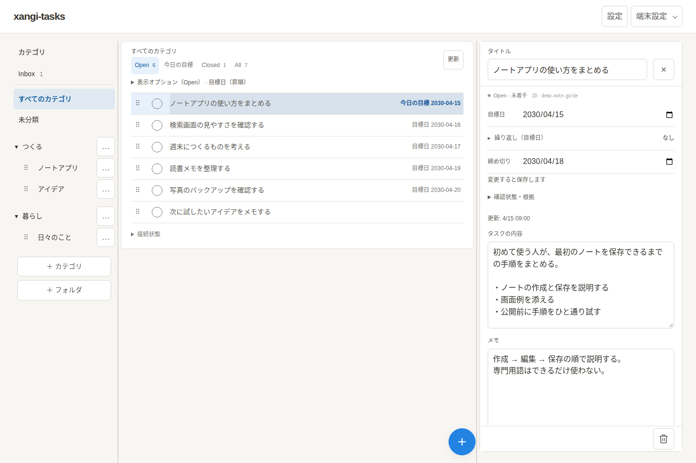

[日本語](README.md) | English

# xangi-tasks

Organize tasks and delegate work to xangi when needed.

  

Actual UI screenshot with fictional tasks, categories, dates, and notes. See [Usage](docs/en/usage.md) for the mobile screenshot and operation, and [README screenshots](docs/en/usage.md#readme-screenshots) to reproduce them.

Requires Node.js 22+ and xangi with Web Chat enabled.

## Documentation

- [Usage, configuration, and verification](docs/en/usage.md)
- [Design and API](docs/en/design.md)
- [Notion linking CLI](docs/en/usage.md#notion-linking-cli)

## License

[MIT](LICENSE)
