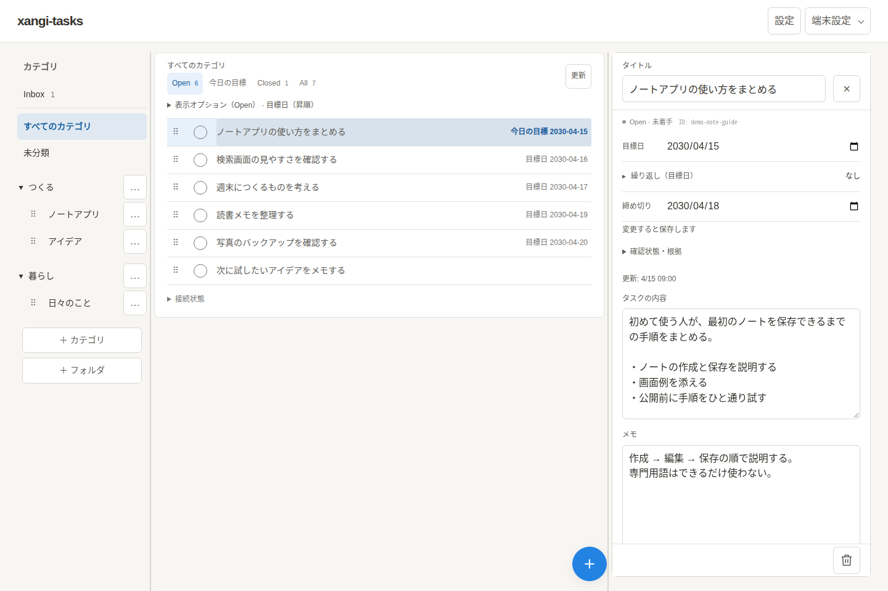

日本語 | [English](README.en.md)

# xangi-tasks

タスクを整理し、必要に応じてxangiへ仕事を依頼できるタスクアプリです。

  

実際のUIに架空のタスク・カテゴリ・日付・メモを表示した画面例です。スマホの画面例と操作は[使い方](docs/usage.md)、再撮影は[スクリーンショットの生成手順](docs/usage.md#readme用スクリーンショット)をご覧ください。

Node.js 22以降と、Web Chatを有効にしたxangiが必要です。

## ドキュメント

- [使い方・設定・動作確認](docs/usage.md)
- [設計・API](docs/design.md)
- [Notion連携CLI（既存ページの登録・確認）](docs/usage.md#notion連携cli)

## ライセンス

[MIT](LICENSE)
