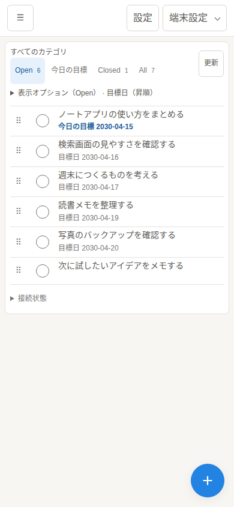

# Usage

## Workflow

<p>
  
</p>

Actual UI screenshot with fictional tasks, categories, and dates. On mobile, open task details from the list.

1. Add and organize tasks.
2. Copy the task link from its details.
3. Paste into xangi to request retrieval or updates.
4. Change task status as needed.

Use the bottom-right + button to open the task form. Closing it (close button or Escape) keeps the draft. Successful creation closes it and switches to Open. Ctrl/Cmd+Enter submits only an open form. On touch devices, tap a field to open the keyboard.

## Setup

Requires Node.js 22+ and xangi with Web Chat enabled.

```bash
npm ci
cp .env.example .env
# Configure XANGI_URL and XANGI_TOKEN before starting
xangi extension link /absolute/path/to/xangi-tasks/xangi-extension.json
xangi extension start xangi-tasks
```

Open xangi-tasks from the xangi Extensions screen. The entrypoint loads the application's `.env`; inherited environment variables take precedence.

- `XANGI_URL`: xangi Web API; defaults to the host URL supplied by xangi.
- `XANGI_TOKEN`: xangi terminal API Bearer token; falls back to `XANGI_EVEN_TERMINAL_TOKEN`.
- `XANGI_PROVIDER`: `codex` or `claude`; default `codex`.
- `XANGI_TASKS_DATA`: task file; default `.data/tasks.json`, resolved from the application root.
- `XANGI_TASKS_POLL_MS`: polling interval for running tasks; default `3000`.

The upstream xangi token stays on the server. xangi-tasks has its own authentication; see Authentication below.

To preserve existing tasks, back up the file and set `XANGI_TASKS_DATA` to its absolute path. Do not run multiple xangi-tasks processes against the same file.

## Candidate API

```bash
xangi tool extension_request --id xangi-tasks --capability xangi-tasks.manage \
  --path /api/inbox --method POST \
  --body-json '{"title":"Wait for the proposal","type":"waiting","sourceText":"I will send the proposal tomorrow"}'
```

Candidate types are `action`, `waiting`, and `hold`. Candidates cannot be delegated until a human confirms them. External updates and outgoing messages require appropriate authorization.

## Verification

1. Create a test task and copy its link.
2. Open the link and verify the selected task details.
3. Retrieve and update its notes through the extension API.
4. Reload and verify the saved notes, then complete the task.

## Development

```bash
npm run lint
npm test
npm run build
```

## Troubleshooting

- Connection failure: check xangi Web Chat, its URL, and the terminal API token.
- Missing tasks: check the filter and `XANGI_TASKS_DATA`.
- `failed`: inspect the error, fix the connection, and delegate again.

[README](../../README.en.md) · [Design](design.md)

Use the copy link button to reference a task in xangi. Task details do not fetch chat history.

Inbox is a separate sidebar destination above categories; category tabs are Open → Closed → All. Confirming a candidate moves it to Open; manually created tasks start there too. Open contains unfinished tasks regardless of execution state; Closed includes completed and dismissed tasks. Completion buttons use the label 完了. DELETE /api/tasks/:id soft-deletes a task after UI confirmation, retaining xangi conversation history. Running/delegating tasks cannot be deleted. Records retain deletedAt and are excluded from listing, lookup, and updates.

To open xangi-tasks inside xangi, link xangi-extension.json and start the extension. xangi starts the application itself on an automatically allocated loopback port. Stopping the extension also stops the application and polling.

Edit changes the title, description, and goal / external deadline. Dates do not trigger reminders or automatic execution. Copy the task link to use it in xangi.

## Goals and external deadlines

A goal must be on or before its confirmed deadline. The same day is allowed. A later goal displays a red warning directly below the goal field, marks that field with a red border, and cannot be saved. Correcting the dates clears the warning. Dates are not compared when either date is unset.

In lists, Open tasks show today’s goal in blue and missed goals in amber. Confirmed deadlines are amber on the due day and red from the following day. Text labels also identify each state. Closed tasks and Inbox candidates are not highlighted. These indicators apply when the date field is enabled for that tab and update after Japan midnight through regular polling (normally every four seconds).

`targetDate` (YYYY-MM-DD) is a personal goal. Today’s goals uses the Japan calendar day. A missed goal asks you to review the plan; it never means an external deadline was missed.

`deadlineAt` is a calendar date in YYYY-MM-DD format. `deadlineStatus` is `unknown` (unverified), `none` (verified absent), or `confirmed` (verified date). Entering a date confirms it; choosing none or unknown clears it. The UI, API, storage and Export/Import use date-only values. Timestamp values are rejected without conversion. Today and overdue comparisons use the Japan calendar day. Store source URLs or quotations in `deadlineEvidence`. Only a confirmed external deadline on an Open task triggers an overdue warning. There is no dedicated upcoming/overdue tab. Show deadlines through Display options in Open or All and sort by deadline.

Recurring tasks advance the goal. External deadlines reset to unknown for the next occurrence rather than being inferred.

Dates alone do not send reminders or execute tasks. AI morning summaries and reminders must read both dates, verification and evidence, plus the API `datePolicy` / `dateSummaries`, and distinguish goals from external deadlines. Delegation includes these meanings and evidence.

## Goal order and repeat

The list shows only goals by default. Display options toggle goals, actual deadlines, recurrence and status. Choose the goal date, actual deadline or creation time in the compact sort field, then select ascending (oldest first) or descending (newest first) separately; undated tasks always come last. Display fields and sort choices persist separately for each tab (Open, Today, Closed and All) in this browser. Tabs without their own preferences inherit the previous shared settings. Categories use the preferences of the current tab. Tab counts reflect the selected category and exclude Inbox candidates. Open tasks with a goal before today in Japan ask you to review the plan.

Choose daily, weekdays (Monday–Friday), weekly, monthly, yearly, or custom (every 1–999 days/weeks/months/years) when creating or editing. Weekly rules accept multiple weekdays; no selection uses the initial goal weekday. Enabling repeat without a goal sets the first goal to today in Japan.

Completing a task keeps its history and creates one next occurrence in Open / idle. Open tasks can also be completed manually. Title, description and repeat carry over; session and results do not. Nothing is automatically delegated or notified. Edit the next task to disable repeat, or delete it to stop. Editing a completed occurrence does not update its successor.

Dates use Japan calendar days. Late completion skips missed dates and chooses the next scheduled date after both the goal and completion day. Weeks start Monday. Month ends clamp to the last valid day but retain the original anchor (Jan 31 → Feb 28 → Mar 31); leap years work similarly. Editing goal or repeat resets the anchor.

Repeat options follow [Microsoft To Do help](https://support.microsoft.com/en-us/todo/add-due-dates-and-reminders-in-microsoft-to-do). Late-completion and month-end rules are the xangi-tasks behavior described above; full Microsoft compatibility or synchronization is not claimed.

### Initial view and task references

The selected category, folder expansion, view tab, and sort order are restored on the next visit in the same browser. A deleted category falls back to all categories. These preferences do not sync across devices.

The first visit opens Open; later visits restore the last view. Copy link adds `?task=<ID>` to the current xangi-tasks URL. Opening it shows task details. If clipboard access is unavailable, a manual copy prompt appears.

Open tasks automatically show progress as a small read-only status label, without a selector or manual start/reset buttons: idle (not started), working (manual work), and review (awaiting review), among other states. POST /api/tasks/:id/execution/start sets working; /execution/reset sets idle. Both keep the task Open. POST /api/tasks/:id/open accepts Inbox or reopens Closed.

## Authentication and storage

Sign in to xangi and open xangi-tasks from Extensions. xangi manages the connection token.

Set `XANGI_TASKS_DATA` to choose the data file. Relative paths are resolved from the application root; the default is `.data/tasks.json`.

## Edit content directly

Open “Verification and evidence” in task details to edit deadline verification, deadline evidence and conversation evidence. It starts collapsed, while dates and category stay visible. Creation and advanced editing also collapse deadline verification and evidence initially. Conversation evidence uses the same neutral styling as other edit fields.

Conversation evidence can be added, edited or cleared in task details: quote, source URL and speaker. Deadline evidence also supports multiple lines. Both save on leaving the field; Enter inserts a newline and Ctrl/⌘+Enter saves. Changes replace stored values. Source URLs must use http/https. The collector key stays unchanged so recollection does not undo corrections or create duplicate candidates.

Select a task name to open its details and edit its title or task content directly. Changes save on leaving a field; Enter also saves the title, and Ctrl/Cmd+Enter saves the content. Plain Enter inserts a newline in the content. IME confirmation does not submit. The content and notes fields start at 180px high and can be resized vertically. Edit the goal and deadline in their compact date rows, and expand goal-based recurrence directly below the goal to change its frequency, interval or weekdays. Move categories by dragging or using the move handle. To delete a task, use the trash icon at the bottom right of its details and confirm.

The save status is visible. Failed drafts remain available for retry. Unsaved or saving changes keep the detail open until saving succeeds. Periodic refreshes do not overwrite active drafts. Internal conversation references stay hidden and are preserved on save.

## Personal notes

Task details include a separate Notes field for ideas and work-in-progress notes, up to 10,000 characters with line breaks. Save by leaving the field or pressing Ctrl/Cmd+Enter. Failed drafts remain available for retry. Notes are not automatically sent to xangi and stay with the current occurrence rather than being copied to the next recurring task.

## Categories, folders and task details

Create categories and one-level folder groups from the left sidebar. Use the adjacent ellipsis button to rename a category or move it to another folder. Each task belongs to one category and can be filtered by category and status. Existing tasks start uncategorized. Recurring tasks retain their category.

On desktop, details open in a right panel while the task list remains interactive. Close with × or Escape. At widths of 900px or less, details use a full-screen modal and closing returns to the list. Pending edits must save before switching tasks. Categories and folders must be empty before deletion.

Back up both the task JSON selected by `XANGI_TASKS_DATA` and its `.collections.json` sidecar. Also save the `.settings.json` sidecar.

### Save to Notion

Save an accessible Notion parent page URL once in Settings at the top of the screen. At the bottom of task details, click Create task page to create a page under that parent. You can also link an existing task page in the expandable section. Open the linked page directly from the task. The parent setting is shared across devices; changing or clearing it does not move or delete existing task pages. Attach a non-empty file up to 20 MiB to each task page. Notion format and plan limits apply.

The server reuses `~/.config/notion/api_key`, as used by xs-notion-manager. Run xangi-tasks as the same OS user, or set `XANGI_TASKS_NOTION_KEY_FILE`. Credentials are never returned to the browser or stored in tasks.

An interrupted page creation is not retried automatically: check Notion and link the created page to avoid duplicates. Check Notion before retrying interrupted uploads too. Link copying tries the Clipboard API, then selection-based copy, and only then offers manual copying.

Drag a task title or its ⠿ grip onto a category (or Uncategorized). Drag a category name or grip onto a folder heading; the “Move outside folders” target appears during category drags. Holding a task over a closed folder reveals its categories. On touch screens use the grip; the rest of the row retains normal scrolling. Valid targets have a highlighted border and background. Clicking or keyboard-activating a grip opens the existing category/folder selector. Save failures are reported and server state is reloaded.

## Task references from xangi

Use extension `xangi-tasks`, capability `xangi-tasks.manage`: `GET /api/tasks/<ID>?history=0` retrieves task data without fetching chat history. `PUT /api/tasks/<ID>` updates title, description, notes and other editable fields. Use `POST /api/tasks/<ID>/execution/start`, `/execution/reset`, `/open` or `/close` for status changes. Existing extension authentication applies; copied links never contain credentials.

Task details offer delegation with a link to its xangi conversation. Candidates appear in Inbox; unfinished tasks share Open and completed tasks appear in Closed.

## Choose an agent or Project

For a task that is not currently being dispatched or running, choose an agent or Project in the delegation dialog. A Project uses its configured agent/team; a Project linked to Discord or Slack creates a channel thread and synchronizes requests and replies. The form identifies the destination before sending. Saving a default does not execute a task and applies across devices.

After acceptance, the conversation opens in a new tab (or window, depending on browser settings), keeping the original task page open. A blank tab appears while submitting and closes if the request fails. If your browser blocks the popup, use “xangiの会話を開く” in task details.

Open conversations are reused. Close the conversation in xangi before requesting a new one or changing its destination. Completing a task does not close its new conversation. Results live in xangi; task details provide a conversation link instead of a separate results panel. Personal notes are not sent automatically.

`GET /api/projects` lists destinations. Settings and delegation accept `projectId` and `agentId`; omission uses the saved default, an empty project means Web only, and a selected project controls the agent. Settings persist in the `.settings.json` sidecar. Back it up alongside task and collection data.

Task links fetch `?task=<ID>` directly, including completed tasks, and open details in the All view. Missing tasks show an error. The bundled `skills/xs-xangi-tasks` skill describes authenticated operations.

## Export / Import

Export downloads all folders, categories, tasks (including candidates and completed tasks), and settings as JSON. No Notion configuration is required. Deleted tasks and credentials are excluded.

Import accepts an exported JSON file up to 20 MiB. Preview its counts, then explicitly replace all existing data. A server-side backup is saved first. Concurrent changes or running tasks prevent import. Imported active tasks become review and do not automatically run. Notion settings are restored, but actual Notion pages/files and xangi conversations are not restored or deleted.

## Candidate collection

The bundled xs-xangi-tasks skill reads important mail from xangi-mail, the owner's platform conversation logs, and selected Google calendars, reviews evidence and later context, and registers candidates without executing them. See the [collection procedure](../../skills/xs-xangi-tasks/references-candidates.md). xangi-mail never pushes tasks. Each source is optional and can be used independently. Calendar collection requires authenticated gogcli and `--calendar-config`; `--calendar-days` defaults to 14. Candidates appear in Inbox and move to Open when confirmed.

POST /api/inbox accepts an optional sourceKey of up to 300 characters. Retrying a key returns the existing record, including rejected or soft-deleted records. GET /api/inbox/capabilities returns sourceKeys:true and statusModel:2. Deferred and ignored decisions are tracked by the collector's private state file.

Open Inbox from the top of the category menu. Candidates show a proposed category that can be changed in details without accepting them. Use the acceptance button to move an item to Open while keeping its category.

## Notion linking CLI

A Notion URL in Notes does not register a task's linked Notion page. The bundled CLI links an existing page and verifies the saved association. It uses uv and the Python standard library; it is not a subcommand of the xangi executable.

Run from the repository root. Set `XANGI_CLI` to the absolute xangi executable path specified by your instance's system context. Use a raw `TASK_ID` after confirming the connection, and an existing page URL or ID for `NOTION_PAGE`.

```bash
uv run python skills/xs-xangi-tasks/scripts/tasks.py --help
uv run python skills/xs-xangi-tasks/scripts/tasks.py --xangi-cli "${XANGI_CLI}" notion link "${TASK_ID}" "${NOTION_PAGE}"
uv run python skills/xs-xangi-tasks/scripts/tasks.py --xangi-cli "${XANGI_CLI}" notion show "${TASK_ID}"
```

`link` replaces any existing association. It does not create pages or edit page content or task notes. It reads the task, calls the linking API, then reads again to compare `notionPageId` and `notionPageUrl`. Success returns the title, status, linked URL and `verified: saved-link`. `uiVerified: false` distinguishes API verification from UI verification. `show` only reads saved values; it does not check current Notion permissions.

Connection, authorization and verification failures exit with code 1. A timeout is not retried automatically; use `show` to check saved state. Existing extension and Notion authentication settings are reused without passing keys to this CLI.

Run CLI regression tests with `npm run test:notion-cli` (requires uv).

## Pane widths

On desktop (901px and wider), drag the boundaries between categories, list and details. The list fills the remaining space. Focus a separator with Tab and use arrow keys (Shift for larger steps), Home/End, or double-click to reset. Widths persist per browser and are constrained on smaller windows to keep the list usable. Mobile retains its category drawer and full-screen details.

Task list and detail API responses include notes in `notes`, so AI can retrieve them when asked to check a task. Notes are not automatically included in the “Delegate to xangi” message.

## README screenshots

From the repository root, run the following to capture the real desktop UI (1440×960px) and mobile UI (390×844px) as `docs/images/tasks-desktop.png` and `docs/images/tasks-mobile.png`.

```bash
npm ci
uv run --with playwright python scripts/readme-screenshots.py
```

Chromium defaults to `/snap/bin/chromium`. Set `BROWSER_EXECUTABLE` to use another installation. Capture uses uv and Playwright without adding application dependencies. The capture environment needs the `ja_JP.UTF-8` locale.

Date input display order depends on the browser language and locale. The script also fixes Chromium's startup language and process locale to Japanese, displaying dates in year/month/day order, such as `2030/04/15`. API and stored values use `2030-04-15`.

The script seeds fictional data in a temporary store and uses a local server with a mock connector. Both browser and server dates are fixed to April 15, 2030, with Japanese UI, Asia/Tokyo time, and a light theme. No real data or credentials are used, and no xangi, Notion, or AI services are contacted. External browser requests are blocked. Task counts, desktop details, horizontal overflow, and JavaScript errors are checked before capture.
