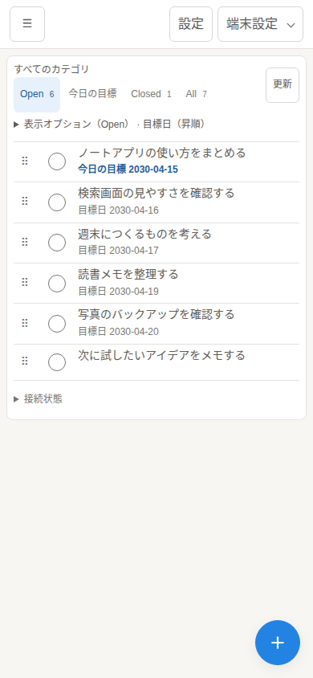

# Usage

## Workflow

<p>
  
</p>

Actual UI screenshot with fictional tasks, categories, and dates. On mobile, open task details from the list.

1. Add and organize tasks.
2. Copy the task link from its details.
3. Paste into xangi to request retrieval or updates.
4. Change task status as needed.

Use the bottom-right + button to open the task form. Closing it (close button or Escape) keeps the draft. Successful creation closes it and switches to Open. Ctrl/Cmd+Enter submits only an open form. On touch devices, tap a field to open the keyboard.

## Setup

Requires Node.js 22+ and xangi with Web Chat enabled.

```bash
npm ci
npm run build
cp .env.example .env
# Configure XANGI_URL and XANGI_TOKEN before starting
xangi extension link /absolute/path/to/xangi-tasks/xangi-extension.json
xangi extension start xangi-tasks
```

Open xangi-tasks from the xangi Extensions screen. The entrypoint loads the application's `.env`; inherited environment variables take precedence.

- `XANGI_URL`: xangi Web API; defaults to the host URL supplied by xangi.
- `XANGI_TOKEN`: xangi terminal API Bearer token; falls back to `XANGI_EVEN_TERMINAL_TOKEN`.
- `XANGI_PROVIDER`: `codex` or `claude`; default `codex`.
- `XANGI_TASKS_DATA`: task file; default `<workspace>/.xangi-tasks/instance-<instance-id>/tasks.json`.
- `XANGI_TASKS_POLL_MS`: polling interval for running tasks; default `3000`.

The upstream xangi token stays on the server. xangi-tasks has its own authentication; see Authentication below.

To preserve existing tasks, back up the file and set `XANGI_TASKS_DATA` to its absolute path. Do not run multiple xangi-tasks processes against the same file.

## Candidate API

```bash
xangi tool extension_request --id xangi-tasks --capability xangi-tasks.manage \
  --path /api/inbox --method POST \
  --body-json '{"title":"Wait for the proposal","type":"waiting","sourceText":"I will send the proposal tomorrow"}'
```

Candidate types are `action`, `waiting`, and `hold`. Candidates cannot be delegated until a human confirms them. External updates and outgoing messages require appropriate authorization.

## Development

```bash
npm run lint
npm test
npm run build
```

## Troubleshooting

- Connection failure: check xangi Web Chat, its URL, and the terminal API token.
- Missing tasks: check the filter and `XANGI_TASKS_DATA`.
- `failed`: inspect the error, fix the connection, and delegate again.

## Task status and deletion

Review candidates in Inbox and accept them into Open. Manually created tasks also start in Open. Open contains unfinished tasks; Closed contains completed and dismissed tasks.

Delete a task using the trash icon in its details. Running or dispatching tasks cannot be deleted. Deleting a task retains its xangi conversation history.

## Goals and external deadlines

A goal must be on or before its confirmed deadline. The same day is allowed. A later goal displays a red warning directly below the goal field, marks that field with a red border, and cannot be saved. Correcting the dates clears the warning. Dates are not compared when either date is unset.

In lists, Open tasks show today’s goal in blue and missed goals in amber. Confirmed deadlines are amber on the due day and red from the following day. Text labels also identify each state. Closed tasks and Inbox candidates are not highlighted. These indicators apply when the date field is enabled for that tab.

`targetDate` (YYYY-MM-DD) is a personal goal. Today’s goals uses the Japan calendar day. A missed goal asks you to review the plan; it never means an external deadline was missed.

`deadlineAt` is a calendar date in YYYY-MM-DD format. `deadlineStatus` is `unknown` (unverified), `none` (verified absent), or `confirmed` (verified date). Entering a date confirms it; choosing none or unknown clears it. The UI, API, storage and Export/Import use date-only values. Timestamp values are rejected without conversion. Today and overdue comparisons use the Japan calendar day. Store source URLs or quotations in `deadlineEvidence`. Only a confirmed external deadline on an Open task triggers an overdue warning. There is no dedicated upcoming/overdue tab. Show deadlines through Display options in Open or All and sort by deadline.

Dates alone do not send reminders or execute tasks. AI morning summaries and reminders must read both dates, verification and evidence, plus the API `datePolicy` / `dateSummaries`, and distinguish goals from external deadlines. Delegation includes these meanings and evidence.

## Goal order and repeat

The list shows goal dates and recurrence frequency, such as “↻ 毎月” (monthly). Display options toggle goals, deadlines and progress.

Choose goal date, deadline or creation time and ascending or descending order. Undated tasks come last; tasks with the same date use newest creation time first. Display and sort preferences are saved per tab in this browser.

Select “↻ 繰り返し” below the goal in task details to choose daily, weekdays (Monday–Friday), weekly, monthly, yearly, or custom (every 1–999 days/weeks/months/years). Weekly rules accept multiple weekdays; no selection uses the initial goal weekday. Enabling repeat without a goal sets the first goal to today in Japan.

Completing a task keeps its history and creates one next occurrence in Open / idle. Open tasks can also be completed manually. Title, description and repeat carry over; session and results do not. Nothing is automatically delegated or notified. Edit the next task to disable repeat, or delete it to stop. Editing a completed occurrence does not update its successor.

Dates use Japan calendar days. Late completion skips missed dates and chooses the next scheduled date after both the goal and completion day. Weeks start Monday. Month ends clamp to the last valid day but retain the original anchor (Jan 31 → Feb 28 → Mar 31); leap years work similarly. Editing goal or repeat resets the anchor.

### Initial view and task references

The selected category, folder expansion, view tab, and sort order are restored on the next visit in the same browser. A deleted category falls back to all categories. These preferences do not sync across devices.

The first visit opens Open; later visits restore the last view. Copy link adds `?task=<ID>` to the current xangi-tasks URL. Opening it shows task details. If clipboard access is unavailable, a manual copy prompt appears.

Open tasks show progress such as idle, working or awaiting review. POST /api/tasks/:id/execution/start sets working; /execution/reset sets idle. Both keep the task Open. POST /api/tasks/:id/open accepts Inbox or reopens Closed.

## Authentication and storage

Sign in to xangi and open xangi-tasks from Extensions. xangi manages the connection token.

Set `XANGI_TASKS_DATA` to choose the data file. Relative paths are resolved from the application root; the default is `<workspace>/.xangi-tasks/instance-<instance-id>/tasks.json`.

## Edit content directly

Select a task name to edit its title, content, goal or deadline. Leave a field or press Ctrl/Cmd+Enter to save. Enter also saves the title.

Content supports task lists, tables, links and code blocks. Checkboxes save immediately. Enter continues a paragraph or list; Shift+Enter inserts a line break within an item; Backspace exits an empty list item; Ctrl/Cmd+Z undoes edits.

Content is stored as Markdown. Raw HTML and comments use a plain-source field. Editing may normalize whitespace or list formatting. Image references are shown without fetching external images.

Open “Verification and evidence” to edit deadline verification, evidence, conversation text, source URL and speaker. Source URLs must use http/https.

Save status appears in the form. Failed drafts remain available through Retry save. Pending edits must save before closing details or switching tasks.

## Personal notes

Notes use the same editing controls as content and allow up to 10,000 characters. They stay with the current task rather than being sent to xangi or copied to the next recurring occurrence. Ask the AI to include notes when reviewing a task.

## Categories, folders and task details

Create categories and one-level folder groups from the left sidebar. Use the adjacent ellipsis button to rename a category or move it to another folder. Each task belongs to one category and can be filtered by category and status. Existing tasks start uncategorized. Recurring tasks retain their category.

On desktop, details open in a right panel while the task list remains interactive. Close with × or Escape. On mobile, details use a full-screen view and closing returns to the list. Pending edits must save before switching tasks. Categories and folders must be empty before deletion.

Back up both the task JSON selected by `XANGI_TASKS_DATA` and its `.collections.json` sidecar. Also save the `.settings.json` sidecar.

### Save to Notion

Save an accessible Notion parent page URL once in Settings at the top of the screen. At the bottom of task details, click Create task page to create a page under that parent. You can also link an existing task page in the expandable section. Open the linked page directly from the task. The parent setting is shared across devices; changing or clearing it does not move or delete existing task pages. Attach a non-empty file up to 20 MiB to each task page. Notion format and plan limits apply.

The server reuses `~/.config/notion/api_key`, as used by xs-notion-manager. Run xangi-tasks as the same OS user, or set `XANGI_TASKS_NOTION_KEY_FILE`. Credentials are never returned to the browser or stored in tasks.

An interrupted page creation is not retried automatically: check Notion and link the created page to avoid duplicates. Check Notion before retrying interrupted uploads too.

Drag a task title or its ⠿ grip onto a category (or Uncategorized). Drag a category name or grip onto a folder heading; the “Move outside folders” target appears during category drags. Holding a task over a closed folder reveals its categories. On touch screens use the grip; the rest of the row retains normal scrolling. Valid targets have a highlighted border and background. Clicking or keyboard-activating a grip opens the existing category/folder selector. Save failures are reported and server state is reloaded.

## Task references from xangi

Use extension `xangi-tasks`, capability `xangi-tasks.manage`: `GET /api/tasks/<ID>?history=0` retrieves task data without fetching chat history. `PUT /api/tasks/<ID>` updates title, description, notes and other editable fields. Use `POST /api/tasks/<ID>/execution/start`, `/execution/reset`, `/open` or `/close` for status changes. Existing extension authentication applies; copied links never contain credentials.

Task details offer delegation with a link to its xangi conversation. Candidates appear in Inbox; unfinished tasks share Open and completed tasks appear in Closed.

## Choose an agent or Project

For a task that is not currently being dispatched or running, choose an agent or Project in the delegation dialog. A Project uses its configured agent/team; a Project linked to Discord or Slack creates a channel thread and synchronizes requests and replies. The form identifies the destination before sending. Saving a default does not execute a task and applies across devices.

After acceptance, the conversation opens in a new tab (or window, depending on browser settings), keeping the original task page open. If your browser blocks the popup, use “xangiの会話を開く” in task details.

Open conversations are reused. Close the conversation in xangi before requesting a new one or changing its destination. Completing a task does not close its new conversation. Results are available through the conversation link. Personal notes are not sent automatically.

`GET /api/projects` lists destinations. Settings and delegation accept `projectId` and `agentId`; omission uses the saved default, an empty project means Web only, and a selected project controls the agent. Settings persist in the `.settings.json` sidecar. Back it up alongside task and collection data.

Task links fetch `?task=<ID>` directly, including completed tasks, and open details in the All view. Missing tasks show an error. The bundled `skills/xs-xangi-tasks` skill describes authenticated operations.

## Export / Import

Export downloads all folders, categories, tasks (including candidates and completed tasks), and settings as JSON. No Notion configuration is required. Deleted tasks and credentials are excluded.

Import accepts an exported JSON file up to 20 MiB. Preview its counts, then explicitly replace all existing data. A server-side backup is saved first. Concurrent changes or running tasks prevent import. Imported active tasks become review and do not automatically run. Notion settings are restored, but actual Notion pages/files and xangi conversations are not restored or deleted.

## Candidate collection

The bundled xs-xangi-tasks skill reads important mail from xangi-mail, the owner's platform conversation logs, and selected Google calendars, reviews evidence and later context, and registers candidates without executing them. See the [collection procedure](../../skills/xs-xangi-tasks/references-candidates.md). xangi-mail never pushes tasks. Each source is optional and can be used independently. Calendar collection requires authenticated gogcli and `--calendar-config`; `--calendar-days` defaults to 14. Candidates appear in Inbox and move to Open when confirmed.

Retrieved text and context are saved in full without a character-count exclusion. Review long sources in ranges through the end and defer decisions if full review is not possible. Missing or truncated mail bodies remain collection errors. Incomplete xangi-tasks review is distinct from Gmail unread status; collection alone does not change that status.

POST /api/inbox accepts an optional sourceKey of up to 300 characters. Retrying a key returns the existing record, including rejected or soft-deleted records. GET /api/inbox/capabilities returns sourceKeys:true and statusModel:2. Deferred and ignored decisions are tracked by the collector's private state file.

Open Inbox from the top of the category menu. Candidates show a proposed category that can be changed in details without accepting them. Use the acceptance button to move an item to Open while keeping its category.

## Notion linking CLI

A Notion URL in Notes does not register a task's linked Notion page. The bundled CLI links an existing page and verifies the saved association. It uses uv and the Python standard library; it is not a subcommand of the xangi executable.

Run from the repository root. Set `XANGI_CLI` to the absolute xangi executable path specified by your instance's system context. Use a raw `TASK_ID` after confirming the connection, and an existing page URL or ID for `NOTION_PAGE`.

```bash
uv run python skills/xs-xangi-tasks/scripts/tasks.py --help
uv run python skills/xs-xangi-tasks/scripts/tasks.py --xangi-cli "${XANGI_CLI}" notion link "${TASK_ID}" "${NOTION_PAGE}"
uv run python skills/xs-xangi-tasks/scripts/tasks.py --xangi-cli "${XANGI_CLI}" notion show "${TASK_ID}"
```

`link` replaces any existing association. It does not create pages or edit page content or task notes. It reads the task, calls the linking API, then reads again to compare `notionPageId` and `notionPageUrl`. Success returns the title, status, linked URL and `verified: saved-link`. `uiVerified: false` distinguishes API verification from UI verification. `show` only reads saved values; it does not check current Notion permissions.

Connection, authorization and verification failures exit with code 1. A timeout is not retried automatically; use `show` to check saved state. Existing extension and Notion authentication settings are reused without passing keys to this CLI.

Run CLI regression tests with `npm run test:notion-cli` (requires uv).

## Pane widths

On desktop (901px and wider), drag the boundaries between categories, list and details. The list fills the remaining space. Focus a separator with Tab and use arrow keys (Shift for larger steps), Home/End, or double-click to reset. Widths persist per browser and are constrained on smaller windows to keep the list usable. Mobile retains its category drawer and full-screen details.

## README screenshots

From the repository root, run the following to capture the real desktop UI (1440×960px) and mobile UI (390×844px) as `docs/images/tasks-desktop.png` and `docs/images/tasks-mobile.png`.

```bash
npm ci
uv run --with playwright python scripts/readme-screenshots.py
```

Chromium defaults to `/snap/bin/chromium`. Set `BROWSER_EXECUTABLE` to use another installation. Capture uses uv and Playwright without adding application dependencies. The capture environment needs the `ja_JP.UTF-8` locale.

Capture uses fictional data and a fixed date. It does not use real data or contact external services.

## Persistent storage and updates

Before a host-managed update, set `XANGI_TASKS_DATA` in the parent instance to the absolute path of an existing task file outside the source directory. Data is not moved or deleted automatically.

The connection normally uses the URL supplied by the host. Set `XANGI_URL` to select another instance. Connection status shows the destination and host default backend/model.

Required host features: managed HTTP schema 2, sessions/chat, agents, runtime-settings, and repository-managed updates.

[README](../../README.en.md) · [Design](design.md)
